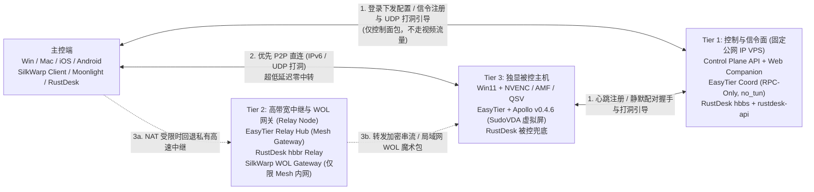

# SilkWarp 架构设计与网络规划

> 本文档描述 **SilkWarp** 的三层混合远控架构、端口分配规范、路由选路策略与安全边界设计。全部域名、IP 与端口均通过环境变量与外部配置文件（`silkwarp.config.json` / `.env`）注入，不硬编码进源码或客户端安装包。

---

## 一、三层混合架构总览

单一云主机往往受限于小带宽上行，而家庭宽带则可能面临动态公网 IP 变动与端口限制。SilkWarp 因此采用“**固定 IP 信令引导 + 高带宽中继枢纽 + 独显物理主机硬编串流**”的三层混合架构：

---

## 二、核心角色与组件分工

### Tier 1 — 控制与信令面（固定公网 IP VPS）
- **定位**：24×7 在线的固定公网控制入口，避免家庭宽带动态 IP 重拨与 DDNS TTL 带来的失联窗口。
- **组件**：
  1. **SilkWarp Control Plane (`server/control-plane/`)**：
     - 零依赖 Python + SQLite WAL HTTP 服务，提供账号认证、Mesh IP 永久静态分配、设备心跳/在线管理、静默配对仲裁与 Web 伴侣页面，置于 Nginx 反向代理之后（端口与路径前缀可配置）。
  2. **EasyTier `v2.6.4`（纯 RPC 协调模式）**：
     - 独立隔离网络名 `silkwarp-coord-only`，开启 `no_tun = true`，不创建虚拟网卡。
     - 配置 `relay_network_whitelist = ""`（禁止数据面中继，避免挤占云主机小带宽）与 `relay_all_peer_rpc = true`（仅转发节点发现与打洞 RPC 包）。
  3. **RustDesk `hbbs` + `rustdesk-api`**：
     - 负责设备 ID 注册、状态在线维护、P2P 打洞协调与团队地址簿同步。
     - 通过 `-r <RELAY_HOST>:<HBBR_PORT> -k _` 强制要求公钥校验，并在 P2P 失败时将中继目标指向 Tier 2 中继节点。

### Tier 2 — 高带宽中继、Mesh 枢纽与 WOL 网关（独立 Relay Node）
- **定位**：承载高上行家庭宽带或专线环境下的中继转发，并作为物理局域网 Wake-on-LAN 唤醒跳板。
- **组件**：
  1. **EasyTier `v2.6.4` 私有中继枢纽**：持有网关虚拟 IP（默认 `10.144.0.1/24`），监听可配置的 TCP+UDP 中继端口（IPv4 + IPv6），`relay_network_whitelist` 仅放行团队私有网络；同时主动出站连接 Tier 1 固定 IP 协调节点，确保动态 IP 变更后毫秒级收敛路由。
  2. **RustDesk `hbbr`**：监听可配置的中继端口，与 Tier 1 `hbbs` 共享完全一致的 `id_ed25519` 密钥对。
  3. **SilkWarp WOL 网关 (`services/wol-helper/silkwarp_wol.py`)**：仅监听 Mesh 虚拟网卡（默认 `10.144.0.1:<WOL_PORT>`），携带 `X-SilkWarp-Token` 认证并向同局域网被控主机发送 Wake-on-LAN 魔术包。

### Tier 3 — 独显被控主机与跨平台主控端
- **主串流引擎选用 Apollo (`v0.4.6`) + Moonlight (`v6.2.0`) / Artemis**：
  - **Apollo** 内置 **SudoVDA 虚拟显示器**，主控端连接时自动按客户端原生分辨率与刷新率建立虚拟屏，断开即销毁。
  - **静默 Cookie 会话认证与免 PIN 自动配对**：SilkWarp 桌面端后台自动部署 Apollo，维护 `/api/login` 会话 Cookie 并在设备配对时由控制中心安全代签 PIN 与授权。
- **辅助运维通道选用 RustDesk**：
  - 负责系统锁屏界面输入、Windows UAC 提权弹窗、剪贴板/文件直传，以及 Apollo 服务异常时的应急接管。

---

## 三、可配置端口与防火墙规范

| 节点 | 配置变量 / 端口 | 协议 | 服务 / 用途 | 暴露范围 |
| :--- | :--- | :--- | :--- | :--- |
| **Tier 1 信令机** | `SILKWARP_CP_PORT`（默认 `18800`） | `TCP` | SilkWarp 控制中心 API / Web UI | **仅 `127.0.0.1`**（由 Nginx HTTPS 反代） |
| Tier 1 信令机 | `SILKWARP_EASYTIER_COORD_PORT`（默认 `11010`） | `TCP + UDP` | EasyTier RPC 信令与打洞引导 | 公网防火墙放行 |
| Tier 1 信令机 | `15888` | `TCP` | EasyTier 本地 RPC 管理接口 | **仅 `127.0.0.1`** |
| Tier 1 信令机 | `21115` | `TCP` | RustDesk `hbbs` NAT 类型探测 | 公网防火墙放行 |
| Tier 1 信令机 | `SILKWARP_RUSTDESK_HBBS_PORT`（默认 `21116`） | `TCP + UDP` | RustDesk `hbbs` ID 注册、心跳与打洞 | 公网防火墙放行 |
| Tier 1 信令机 | `SILKWARP_RUSTDESK_API_PORT` | `TCP` | `rustdesk-api` HTTPS 网关 | Nginx SSL 代理暴露 |
| **Tier 2 中继机** | `SILKWARP_EASYTIER_RELAY_PORT`（默认 `11011`） | **`TCP + UDP`** | EasyTier 私有中继与 P2P 监听 | 网关/Nginx `stream` 映射放行 |
| Tier 2 中继机 | `SILKWARP_RUSTDESK_HBBR_PORT`（默认 `21117`） | `TCP` | RustDesk `hbbr` 高速中继 | 网关/Nginx `stream` 映射放行 |
| Tier 2 中继机 | `SILKWARP_WOL_PORT`（默认 `9580`） | `TCP` | SilkWarp WOL 唤醒服务 | **仅 Mesh 内网网关 IP** |
| **Windows 被控端** | `47984,47989,47990,48010` | `TCP` | Apollo WebUI / RTSP / Control | **Windows 防火墙仅放行 `SILKWARP_MESH_CIDR`** |
| Windows 被控端 | `47998-48000,48002,48010` | `UDP` | Apollo 视频 / 音频 / 键鼠手柄流 | **Windows 防火墙仅放行 `SILKWARP_MESH_CIDR`** |

---

## 四、选路与传输策略

1. **P2P 优先，低延迟自动选路**：所有节点开启 `latency_first = true` 与 `multi_thread = true`（以及 `enable_ipv6 = true`）。双方 NAT 允许打洞或具备公网 IPv6 时直接端到端直连，不经过任何中继节点。
2. **中继防误走小带宽信令机**：Tier 1 仅加入独立隔离的 `silkwarp-coord-only` 网络且 `relay_network_whitelist = ""`，确保 NAT 穿透失败时仅回退至 Tier 2 高带宽中继节点。
3. **快速路由收敛**：Tier 2 中继节点既监听入站端口，又主动向固定 IP Tier 1 保持长连接，家宽公网 IP 变更后仍可在控制层瞬间重新交换可达路由。

---

## 五、安全边界

- **配置与源码解耦**：`.gitignore` 严格排除 `silkwarp.config.json`、`secrets/`、`*.env`、`*.pem`/`*.key`、`*.xlsx`、`*.docx`、桌面端构建产物与本地环境评测报告。
- **控制面与数据面最小授权**：
  - 桌面端客户端安装包不内嵌任何私网密码、域名、公网 IP 或服务商端口。
  - Apollo 串流端口不对公网暴露，Windows 防火墙白名单限制为私网 Mesh CIDR。
  - RustDesk 启用 `-k _` 强制公钥校验，非团队客户端无法接入。
  - WOL 网关仅绑定 Mesh 内网地址并强制 `X-SilkWarp-Token` 认证。
